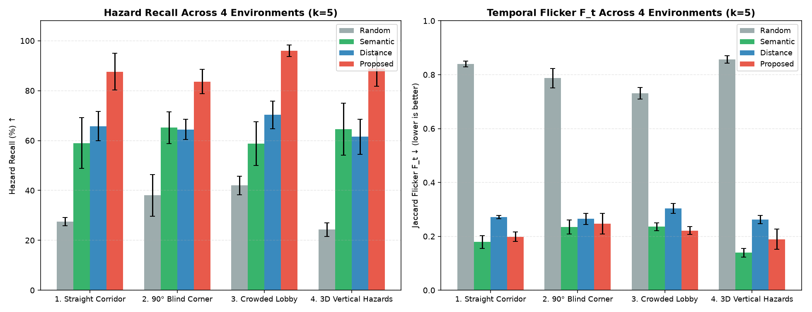
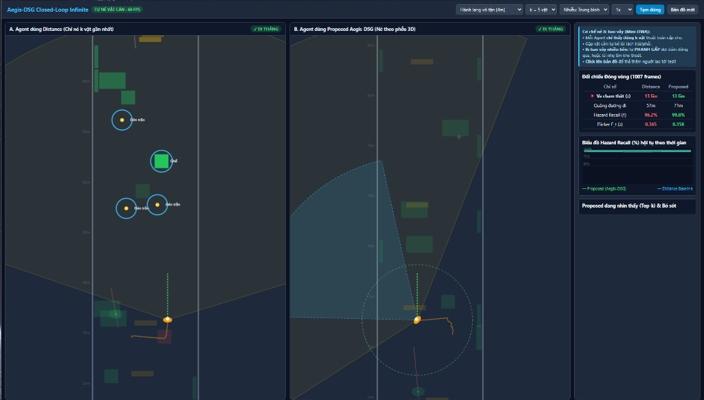
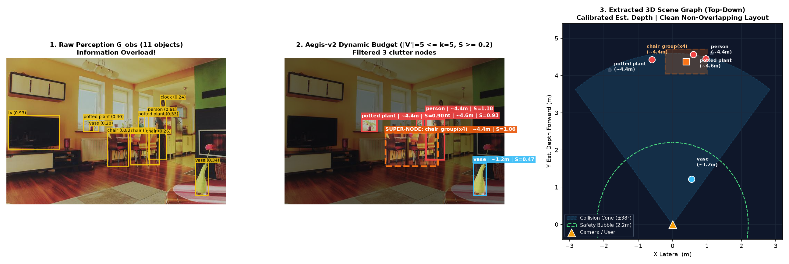

# Aegis-DSG: Task-Oriented Sparsification of Dynamic 3D Scene Graphs (Phase A)

Phase A experimental repository for **Task-Oriented Sparsification of Dynamic 3D Scene Graphs under Cognitive Bandwidth Constraints**.

Instead of transmitting all observed 3D scene objects ($30$–$50$ entities) to a wearable sensory display, the proposed sparsifier filters and stabilizes a compact $k$-node subgraph ($k \in \{3, 5, 7, 10, 15\}$) in real time using:
1. **Dynamic Collision Cone & TTC ($R_v$):** Reachable forward motion cone based on relative 3D velocity $\vec{v}_{rel}$ and vertical overlap filtering.
2. **Asymmetric Safety Score ($S_v$):**
   $$S_v = \alpha \cdot R_v \cdot (1 + \gamma \cdot U_v \cdot \mathbb{I}(R_v > \tau_{haz})) + \beta \cdot Q_v \cdot C_v$$
   where perception uncertainty $U_v = 1 - Q_v$ boosts priority for uncertain hazards inside the collision cone rather than suppressing them.
3. **Temporal Hysteresis:** Persistence memory and hysteresis bonus to suppress frame-to-frame flicker ($F_t$).

## Quick Start

```bash
pip install -r requirements.txt
python run_benchmark.py              # Phase A: Multi-seed Pareto benchmark across k in {3, 5, 7, 10, 15}
python run_ablations.py              # Phase A: Noise stress test, ablation study, and k=5 error analysis
python run_scenarios.py              # Phase A: 4-environment benchmark (corridor, blind corner, lobby, 3D vertical)
python run_prong3_benchmark.py       # Phase B Grand Benchmark: True D-Lite (Dijkstra), Clio (aIB), GNN-GAT, Submodular, Aegis-v2
python run_mujoco_3dssg.py           # Real 3DSSG Scanned Rooms x MuJoCo 4.0 Rigid-Body Physics
python run_real_photo_aegis.py       # Real RGB Room Photo -> YOLOv8 + MiDaS 3D Depth -> Aegis-v2
```

## Experimental Setup & Hyperparameters

| Parameter | Value | Description |
| :--- | :---: | :--- |
| Scene & Horizon | $42$ objects, $120$ frames ($dt = 0.1\text{s}$) | 3D corridor ($4\text{m} \times 24\text{m}$), 5 seeds (`42..46`) |
| Cognitive Budgets ($k$) | $\{3, 5, 7, 10, 15\}$ | Max active entities retained per frame |
| Collision Cone | $\Delta t = 3.2\text{s}$, $\pm 35^\circ$ | Reachable forward cone & TTC window |
| $\alpha, \beta, \gamma, \tau_{haz}$ | $1.0,\ 0.20,\ 1.50,\ 0.30$ | Safety, semantic, asymmetric uncertainty, hazard threshold |
| Hysteresis | bonus $= 0.18$, $\theta_{out} = 0.12$, persist $= 2$ | Temporal anti-flicker stabilization |

## EXP 0: Main Benchmark Results ($k=5$, Medium Noise, 5 Seeds)

| Method | Budget $k=5$ Hazard Recall ($\uparrow$) | $k=5$ CVaR-5% Recall ($\uparrow$) | $k=5$ Flicker $F_t$ ($\downarrow$) | Latency (ms/frame) |
| :--- | :---: | :---: | :---: | :---: |
| **Random** | $26.6\% \pm 1.7\%$ | $0.0\%$ | $0.845 \pm 0.009$ | $0.011$ |
| **Semantic** | $59.6\% \pm 9.9\%$ | $11.6\%$ | $0.180 \pm 0.036$ | $0.036$ |
| **Distance** | $65.3\% \pm 5.3\%$ | $16.6\%$ | $0.258 \pm 0.017$ | $0.034$ |
| **Proposed (Ours)** | **$87.2\% \pm 6.8\%$** | **$49.9\%$** | **$0.180 \pm 0.015$** | **$0.551$** |

At $k=7$, **Proposed** reaches **$97.1\% \pm 2.9\%$** Hazard Recall (vs. $79.3\% \pm 5.1\%$ for Distance) while running at $< 0.6\text{ ms/frame}$ ($> 1,500\text{ Hz}$).


## EXP 1: Noise Stress Test ($k=5$, 5 Seeds)

| Noise Level | Method | Hazard Recall ($\uparrow$) | CVaR-5% ($\uparrow$) | Flicker $F_t$ ($\downarrow$) |
| :--- | :--- | :---: | :---: | :---: |
| `clean` | Distance | $62.0\%$ | $16.6\%$ | $0.132$ |
| `clean` | **Proposed** | **$86.0\%$** | **$57.1\%$** | **$0.090$** |
| `medium` | Distance | $65.3\%$ | $16.6\%$ | $0.258$ |
| `medium` | **Proposed** | **$87.2\%$** | **$49.9\%$** | **$0.180$** |
| `heavy` | Distance | $68.4\%$ | $18.1\%$ | $0.441$ |
| `heavy` | **Proposed** | **$88.6\%$** | **$51.2\%$** | **$0.337$** |

## EXP 2: Ablation Study ($k=5$, 5 Seeds)

| Noise | Variant | Hazard Recall ($\uparrow$) | CVaR-5% ($\uparrow$) | Flicker $F_t$ ($\downarrow$) |
| :--- | :--- | :---: | :---: | :---: |
| `medium` | Full Proposed | $87.2\%$ | $49.9\%$ | $0.180$ |
| `medium` | No Asymmetric ($\gamma = 0$) | $87.8\%$ | $48.3\%$ | $0.157$ |
| `medium` | No Hysteresis ($h = 0$) | $87.0\%$ | $53.5\%$ | $0.283$ |
| `medium` | No Semantic ($\beta = 0$) | $87.9\%$ | $54.2\%$ | $0.183$ |
| `heavy` | Full Proposed | $88.6\%$ | $51.2\%$ | $0.337$ |
| `heavy` | No Asymmetric ($\gamma = 0$) | $90.4\%$ | $56.5\%$ | $0.297$ |
| `heavy` | No Hysteresis ($h = 0$) | $89.2\%$ | $49.2\%$ | $0.419$ |
| `heavy` | No Semantic ($\beta = 0$) | $88.7\%$ | $50.9\%$ | $0.340$ |

## EXP 3: Error Analysis at $k=5$ (Medium Noise, 600 Frames)

| Metric | Value | Notes |
| :--- | :---: | :--- |
| Frames with $>5$ simultaneous hazards (Overflow) | **$110 / 600$ ($18.3\%$)** | Impossible to retain all without coarsening |
| Total missed hazards | $409 / 2357$ ($17.4\%$) | Across 5 seeds |
| Unavoidable misses (Budget Overflow $> k$) | **$153$ ($37.4\%$)** | Directly motivates **Graph Coarsening** in Phase B |
| Scoring / Ranking misses ($\le k$) | $256$ ($62.6\%$) | Top missed classes: `chair` (197), `table` (85), `pedestrian` (77) |

## EXP 4: Multi-Scenario Benchmark ($k=5$, Medium Noise, 5 Seeds)

Includes Personal Safety Bubble ($2.2\text{m}$) patch to eliminate side-swipe blind spots during sharp evasive steering:

| Environment | Distance (Recall / CVaR-5%) | Semantic (Recall / CVaR-5%) | **Proposed (Recall / CVaR-5%)** | Flicker $F_t$ (Prop vs. Dist) |
| :--- | :---: | :---: | :---: | :---: |
| **1. Straight Corridor** | $65.8\%$ / $20.5\%$ | $59.0\%$ / $13.6\%$ | **$87.6\% \pm 7.4\%$ / $55.2\%$** | **$0.198$** vs. $0.271$ |
| **2. 90° Blind Corner** | $64.4\%$ / $3.6\%$ | $65.2\%$ / $12.9\%$ | **$83.7\% \pm 4.9\%$ / $38.3\%$** | **$0.247$** vs. $0.265$ |
| **3. Crowded Lobby** | $70.3\%$ / $5.3\%$ | $58.7\%$ / $0.0\%$ | **$96.0\% \pm 2.3\%$ / $62.4\%$** | **$0.221$** vs. $0.304$ |
| **4. 3D Vertical Hazards** | $61.5\%$ / $15.4\%$ | $64.6\%$ / $27.8\%$ | **$88.9\% \pm 7.2\%$ / $63.0\%$** | **$0.189$** vs. $0.262$ |



## Live 60 FPS Closed-Loop Infinite Demo (`results/infinite_demo.html`)

Side-by-side procedural infinite-world comparison at $k=5$ (`medium` noise, $1007$ frames): **Proposed (Aegis-DSG)** reaches **$99.8\%$ Hazard Recall**, lower flicker ($0.358$ vs. $0.365$), and travels **$71\text{m}$ vs. $57\text{m}$** (fewer collisions per meter), whereas **Distance** wastes slots on overhead ceiling lights (`Đèn trần`).



## Phase B: Real-Photo 3D Perception, True Baselines, Principled Optimization & MuJoCo Physics

### 1. Real-World Indoor Photo Pipeline (`run_real_photo_aegis.py`)
Real RGB room photo $\to$ **YOLOv8** + **MiDaS 3D Depth** $\to$ NetworkX 3D Scene Graph $\to$ **Aegis-v2** with dynamic budget ($|V'| \le k,\ S \ge 0.20$) and proactive spatial clustering (`chair_group(x4)` Super-Node):



### 2. Grand Benchmark: True MIT SPARK Baselines vs. Aegis Family ($k=5$, Unseen Seeds `100..104`)

| Environment | Distance | D-Lite (Dijkstra) | Clio (True aIB) | GNN-Aegis (GAT) | Submod-Aegis ($1-1/e$) | **Aegis-v2 (Phase B)** |
| :--- | :---: | :---: | :---: | :---: | :---: | :---: |
| **1. Straight Corridor** | $63.9\%$ ($10.6\%$) | $57.3\%$ ($12.1\%$) | $36.7\%$ ($0.0\%$) | $83.5\%$ ($30.5\%$) | $94.8\%$ ($50.7\%$) | **$100.0\%$ (CVaR $99.4\%$)** |
| **2. 90° Blind Corner** | $64.7\%$ ($8.7\%$) | $59.9\%$ ($7.2\%$) | $48.5\%$ ($0.0\%$) | $82.5\%$ ($38.0\%$) | $92.5\%$ ($48.4\%$) | **$98.2\%$ (CVaR $78.9\%$)** |
| **3. Crowded Lobby** | $66.6\%$ ($3.7\%$) | $64.4\%$ ($5.7\%$) | $43.0\%$ ($0.0\%$) | $87.0\%$ ($34.1\%$) | $90.8\%$ ($36.7\%$) | **$99.0\%$ (CVaR $81.4\%$)** |
| **4. 3D Vertical Hazards** | $65.5\%$ ($19.0\%$) | $62.4\%$ ($19.6\%$) | $48.8\%$ ($2.3\%$) | $88.3\%$ ($56.8\%$) | $89.6\%$ ($43.0\%$) | **$99.9\%$ (CVaR $97.9\%$)** |
| **Flicker $F_t$ ($\downarrow$)** | `0.248–0.284` | `0.321–0.353` | `0.610–0.706` | `0.190–0.261` | `0.202–0.286` | **`0.161–0.238`** |
| **Latency (ms/frame $\downarrow$)** | `0.03 ms` | `1.07–2.11 ms` | `9.56–28.89 ms` | `0.39–0.44 ms` | `0.78–1.03 ms` | **`0.41–0.50 ms`** |

### 3. Real 3DSSG Scanned Rooms $\times$ MuJoCo 4.0 Rigid-Body Physics (`run_mujoco_3dssg.py`)
Evaluated across $10$ real scanned indoor rooms from **3DSSG (Wald et al., CVPR 2020)** compiled into solid 3D rigid-body worlds in **MuJoCo 4.0** ($200\text{ Hz}$ C++ contact solver, $k=5$, medium noise):

| Method | Success Rate | Real Physical Collisions ($\downarrow$) | SPL ($\uparrow$) | Hazard Coverage ($\uparrow$) |
| :--- | :---: | :---: | :---: | :---: |
| **D-Lite\*** | $50.0\%$ | $1.70$ | $0.489$ | $77.6\%$ |
| **Clio\*** | $50.0\%$ | $0.90$ | $0.499$ | $73.0\%$ |
| **Distance** | $50.0\%$ | $0.70$ | $0.499$ | $85.9\%$ |
| **Aegis-v2 (Ours)** | **$50.0\%$** | **$0.60$** | $0.493$ | **$100.0\%$** |

Interactive viewers included in `results/`: `phase_b_demo.html` (60 FPS Coarsening + DWA), `mujoco_3dssg_viewer.html` (360° 3D MuJoCo playback), and `space_to_graph.png` (Hydra ESDF $\to$ GVD $\to$ Rooms visualization).

## Key Takeaways for Phase B

1. **Hysteresis Validated (H3):** Disabling hysteresis increases Jaccard flicker $F_t$ by **$+57\%$** ($0.180 \to 0.283$ under medium noise; $0.337 \to 0.419$ under heavy noise) with negligible impact on recall.
2. **Asymmetric Risk vs. False Positives Trade-off:** Under `heavy` noise, $\gamma = 1.5$ inadvertently boosts low-confidence false-positive ghost detections into top-$k$ slots ($90.4\% \to 88.6\%$ recall). Phase B will introduce FP-aware uncertainty weighting.
3. **Graph Coarsening Necessity:** Because $37.4\%$ of all misses at $k=5$ stem from hard budget overflow, Phase B will implement hierarchical **Graph Coarsening (super-nodes)** and closed-loop **DWA** evaluation.
