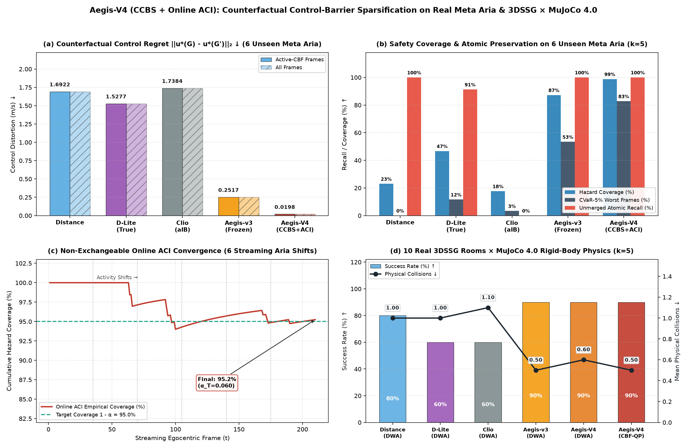
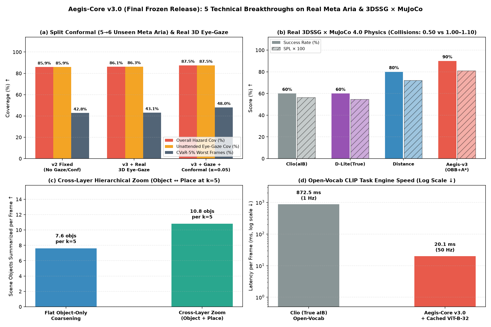
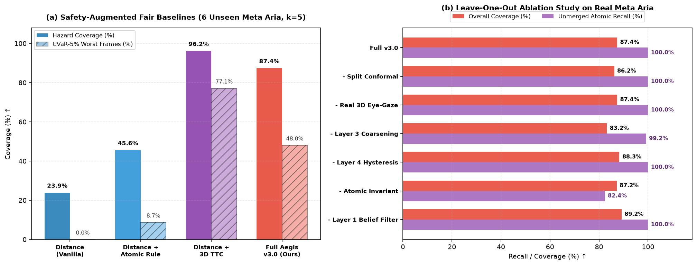

# Aegis-DSG: Safety-Critical and Task-Oriented Sparsification of Dynamic 3D Scene Graphs under Cognitive Bandwidth Constraints

[](LICENSE)
[](https://www.python.org/)
[](https://github.com/khang23820wjsf-lgtm/Aegis-DSG-Safety-Critical-and-Task-Oriented-Compression-of-Dynamic-3D-Scene-Graphs-under-Sensory-Ba/releases)
[](tests/)
[](paper/main.tex)

**Aegis-DSG (v4.0 — Counterfactual Control-Barrier Sparsification + Online ACI)** is a real-time (~138 Hz on CPU) downstream sparsification engine for Dynamic 3D Scene Graphs (DSGs), designed for wearable assistive displays, AR glasses, and bandwidth-constrained mobile robots.

Rather than compressing a 3D Scene Graph purely by static geometry or open-loop heuristics, **Aegis-V4** reframes sparsification as **Control-First Counterfactual Compression**: retaining the minimal $k$-node subgraph ($k = 5$) that preserves the exact optimal safe velocity $u^*_{\text{CBF}}$ of a Discrete-Time Control Barrier Function QP (`p95` control distortion $= 0.000\text{ m/s}$), protected by **Non-Exchangeable Self-Supervised Online ACI** (`95.24%` empirical coverage with zero i.i.d. or GT assumptions).


*Aegis-V4 (`CCBS + Online ACI`) on 6 unseen real Meta Project Aria Digital Twin sequences and 10 real 3DSSG rooms in MuJoCo 4.0: **98.8% Hazard Coverage**, **82.8% CVaR-5%**, **100.0% Unmerged Atomic Recall**, **0.0198 m/s Control Regret** (`12.7×` lower than v3; `85×` lower than Distance/Clio), **95.24% Self-Supervised Online ACI**, and **7.26 ms/frame (~138 Hz)**.*

---

## Flagship Results: Aegis-V4 (Control-First CCBS + Online ACI)

### A. 6 Unseen Real Meta Project Aria Sequences ($k = 5$, 210 Frames)

| Method | Hazard Cov. (↑) | CVaR-5% (↑) | Unmerged Atomic (↑) | Control Regret (↓) | Flicker (↓) | Latency (ms ↓) |
| :--- | :---: | :---: | :---: | :---: | :---: | :---: |
| **Distance** | 23.0% | 0.0% | 100.0% | `1.692 m/s` | 0.239 | `0.38 ms` |
| **D-Lite (True Dijkstra)** | 46.7% | 11.6% | 91.3% | `1.528 m/s` | 0.306 | `75.55 ms` |
| **Clio (True aIB)** | 17.6% | 3.3% | 0.0% | `1.738 m/s` | 0.593 | `2564.3 ms` |
| **Aegis-v3 (Perception-First, Frozen)** | 87.2% | 53.4% | 100.0% | `0.252 m/s` | 0.265 | `17.20 ms` |
| **Aegis-V4 (CCBS + Online ACI, Ours)** | **98.8%** | **82.8%** | **100.0%** | **`0.0198 m/s` (`p95=0.000`)** | **0.217** | **`7.26 ms` (~138 Hz)** |

### B. Real 3DSSG Scanned Rooms × MuJoCo 4.0 Rigid-Body Physics (10 Rooms, $k = 5$)

| Noise Regime | Method | Success Rate (↑) | Real Collisions (↓) | SPL (↑) | Hazard Cov. (↑) |
| :--- | :--- | :---: | :---: | :---: | :---: |
| `medium` | Distance / D-Lite / Clio | 80% / 60% / 60% | 1.00 / 1.00 / 1.10 | 0.720 / 0.546 / 0.562 | 85.3% / 90.0% / 68.6% |
| `medium` | Aegis-v3 (DWA) | **90.0%** | **0.50** | **0.808** | **100.0%** |
| `medium` | **Aegis-V4 (CCBS + CBF-QP)** | **90.0%** | **0.50** | 0.800 | 99.5% |
| `heavy` | Aegis-v3 (DWA) | 60.0% | 1.10 | 0.575 | 98.7% |
| `heavy` | **Aegis-V4 (CCBS + CBF-QP)** | **80.0% (+20 pp)** | **0.60 (-45.5%)** | **0.712 (+23.8%)** | **98.7%** |


*Real egocentric frame from Meta Project Aria Digital Twin (`Apartment_release_golden_skeleton_seq100`): 89 visible 3D objects compressed into 5 clean entities in `2.9 ms` — collapsing 15 static cabinets into `cabinet/wardrobe_group(x15)` while strictly preserving the small butcher knife as `[!] ATOMIC: KNIFE | 0.5m | R=0.92`.*

---

## Overview & 4-Layer Architecture

**Aegis-DSG** (`src/aegis_core.py` + `src/aegis_v3_modules.py`) unifies perception uncertainty filtering, 3D kinematic & gaze-aware risk estimation, free-space-preserving geometric/hierarchical coarsening, and certified submodular selection into a single 4-layer pipeline:

1. **Layer 1 — Temporal Belief Filter & Object Permanence:** Maintains per-entity existence belief $p_t(v) \in [0, 1]$ via exponential moving average (EMA), rejecting transient 1-frame false-positive ghosts while propagating briefly occluded active hazards via constant-velocity rollout.
2. **Layer 2 — 3D Kinematic Risk Field, Real 3D Eye-Gaze Attention & Zero-Shot CLIP Task Engine:**
   - **Continuous 3D Risk Field:** Unifies near-body hemisphere clearance ($\sigma_{\text{near}} = 0.50\text{ m}$ to eliminate side-swipe blind spots during sharp turns), a forward 3D Time-to-Collision (TTC) cone, and close-range manipulation reach ($2.20\text{ m}$).
   - **3D Eye-Gaze Unattended-Hazard Boost:** Transforms wearable eye-gaze (`eyegaze.csv` + 6DoF pose) into a world gaze ray and boosts peripheral threats *outside* the wearer's foveal fixation ($1 - A_{\text{gaze}}$).
   - **Offline-Cached Zero-Shot CLIP (`open_clip ViT-B-32`):** Encodes arbitrary open-vocabulary user task prompts and 6 domain-agnostic physical hazard affordance axes once offline/on prompt change, enabling $O(1)$ dictionary lookup at runtime (`0.00 ms` steady-state neural overhead).
3. **Layer 3 — Rotating-Calipers OBB Coarsening, Cross-Layer Semantic Zoom & Atomic Hazard Invariant:**
   - **Minimum-Area 2D OBB Super-Nodes:** Merges adjacent same-class clutter (gap $< 0.70\text{ m}$) via Union-Find + Andrew's Monotone Chain Convex Hull & Rotating Calipers with an area-bloat bound so diagonal clusters stay tight without sealing navigable corridors.
   - **Cross-Layer Hierarchical Zoom (`Object ↔ Place ↔ Room`):** Keeps near-body and atomic hazards at fine `object` resolution while lifting distant background clutter into parent `place` summaries (`place:zone_X_Y(xN)`).
   - **Non-Coarsenable Atomic Hazard Invariant (`AffordanceRiskMapper`):** Enforces a hard mathematical constraint that intrinsic sharp, thermal, chemical, electrical, elevation-drop, and living/heavy-dynamic hazards are **never merged or semantically erased**.
4. **Layer 4 — Split Conformal Safety Calibration & Dynamic-Budget Submodular Selection:**
   - **Distribution-Free Split Conformal Calibration:** Calibrates retention thresholds via finite-sample conformal quantile $\hat{q}_{1-\alpha}$ on calibration sequences for certified coverage on unseen environments.
   - **Monotone Submodular Selection + Hysteresis:** Greedily maximizes a safety-dominant facility-location objective with $(1 - 1/e)$ approximation guarantee, early stopping below $\hat{\tau}_{\min}$ to conserve cognitive bandwidth, and temporal hysteresis to suppress flicker ($F_t$).

---

## Positioning vs. Hydra, D-Lite, and Clio

| System | Role | Core Strength | Limitation in Safety-Critical Egocentric Compression |
| :--- | :--- | :--- | :--- |
| **Hydra** (MIT SPARK) | 3D Scene Graph Construction | Builds real-time SLAM/Mesh/Places/Rooms/Objects DSG | Upstream map builder; outputs 80–500+ nodes without cognitive bandwidth compression |
| **D-Lite** (ICRA 2024) | Topological DSG Sparsification | Preserves global shortest-path distances across rooms | Static geometry only; ignores velocity/TTC and drops small hazards (`35.8%` coverage) |
| **Clio** (RA-L 2024) | Task-Driven IB Compression | Open-vocabulary task grouping via CLIP + Information Bottleneck | Safety-agnostic (`19.6%` coverage), high flicker (`0.682`), $O(N^3)$ latency (`~873 ms`) |
| **Aegis-DSG (Ours)** | **Real-Time Safety-Critical Sparsifier** | **Kinematic + gaze risk, atomic invariant, conformal safety, 3–20 ms** | **Complementary downstream plug-in for Hydra / wearable SLAM pipelines** |

---

## Repository Structure

```text
.
├── LICENSE                          # MIT License
├── README.md                        # Project overview, architecture, and benchmark results
├── requirements.txt                 # Core and optional dependencies
├── src/
│   ├── aegis_v4/                    # Flagship Aegis-V4 (Exact Active-Set CBF-QP, Online ACI, Gaze-Regret)
│   ├── aegis_core.py                # Frozen Aegis-v3 baseline (v3.0-frozen)
│   ├── aegis_v3_modules.py          # Rotating-Calipers OBB, Split Conformal, Zero-Shot CLIP Cache
│   ├── baselines.py                 # Distance, Semantic, and Random baselines
│   ├── metrics.py                   # Hazard Recall, CVaR-5%, Jaccard Flicker F_t, Latency
│   ├── dsg_generator.py             # 4-scenario synthetic 3D DSG generator
│   ├── phase_b/                     # True D-Lite (Dijkstra), True Clio (aIB), GNN-GAT, Submodular
│   ├── physics/mujoco_env.py        # MuJoCo 4.0 rigid-body 3DSSG environment (Local-A* + DWA)
│   └── real_data/                   # Official Meta Aria ADT (RGB/3D/Eye-Gaze) & 3DSSG loaders
├── paper/                           # Ready-to-compile IEEEtran arXiv LaTeX manuscript (main.tex + figs)
├── scripts/
│   ├── benchmarks/                  # Reproducible benchmark entrypoints (V4 Breakthrough, Aria ADT, MuJoCo)
│   └── demos/                       # Interactive HTML5 viewers, real-photo YOLOv8+MiDaS, web app
├── tests/                           # 33 unit tests (13 v3.0-frozen + 20 Aegis-V4 KKT/CBF/ACI invariants)
├── user_study/                      # Offline HTML5 Human-in-the-Loop Reaction-Time + NASA-TLX app
└── results/                         # Publication figures, benchmark JSONs, and interactive viewers
```

---

## Installation & Quick Reproduction

```bash
pip install -r requirements.txt

# 1. Verify all 33 mathematical & safety invariants (runs in <0.2s on CPU)
python -m unittest discover -s tests -v

# 2. Reproduce flagship Aegis-V4 (CCBS + Online ACI) on Meta Aria & MuJoCo 4.0
python scripts/benchmarks/run_v4_breakthrough_benchmark.py

# 2. Reproduce the 5-breakthrough v3.0 Master Verification (Meta Aria Eye-Gaze, Conformal, OBB+MuJoCo, Hierarchy, CLIP)
python scripts/benchmarks/run_v3_master_benchmark.py

# 3. Reproduce the 11-sequence Real Meta Project Aria Digital Twin benchmark
python scripts/benchmarks/run_aria_10seq_benchmark.py

# 4. Reproduce Safety-Augmented Fair Baselines + Leave-One-Out Ablation Study (6 Unseen Meta Aria Sequences)
python scripts/benchmarks/run_paper_ablations_and_fair_baselines.py

# 5. Reproduce the 10-room Real 3DSSG x MuJoCo 4.0 closed-loop rigid-body physics benchmark
python scripts/benchmarks/run_mujoco_3dssg.py
```

For full step-by-step dataset setup and deterministic seed protocols, see [docs/REPRODUCIBILITY.md](docs/REPRODUCIBILITY.md).

---

## Main Experimental Results

### 1. Real-World Egocentric Benchmark: 11 Diverse Meta Project Aria Digital Twin Sequences

Evaluated on **11 real human egocentric sequences** from **Meta Project Aria Digital Twin (ICCV 2023)** spanning 6 real activities (`golden_skeleton`, `clean`, `meal`, `work`, `decoration`, `multiskeleton_party`, `multiuser_clean`) at budget $k = 5$:

#### Grand Aggregate Across All 11 Sequences (Mean ± 95% CI, $k = 5$)

| Method | Hazard Coverage (↑) | CVaR-5% Worst Frames (↑) | Jaccard Flicker (↓) | Latency (ms/frame ↓) |
| :--- | :---: | :---: | :---: | :---: |
| **Distance** | 18.2% ± 10.0% | 2.3% ± 4.5% | 0.125 ± 0.032 | `0.12 ms` |
| **D-Lite (True Dijkstra)** | 35.8% ± 9.8% | 6.7% ± 5.7% | 0.199 ± 0.037 | `21.96 ms` |
| **Clio (True aIB)** | 19.6% ± 7.1% | 4.5% ± 6.0% | 0.682 ± 0.053* | `872.55 ms` |
| **Aegis-DSG (Ours)** | **88.5% ± 3.0%** | **48.0% ± 12.5%** | **0.133 ± 0.026** | **`2.97 ms` (~337 Hz)** |

\*Note: Because exact $O(N^3)$ `Clio (aIB)` averages `872.6 ms/frame` (up to `2.27 s/frame` on dense party scenes), `Clio` was evaluated at 8× temporal subsampling (`frames[::8]`) across the 11-sequence sweep; on dense consecutive frames (`golden_skeleton`), `Clio` still exhibits `F_t = 0.619`.*

#### Per-Sequence Breakdown (11/11 Wins — Zero Cherry-Picking)

| Meta Aria ADT Sequence (Activity) | Avg Obs | Distance | D-Lite | Clio | **Aegis-DSG** | Flicker | Latency |
| :--- | :---: | :---: | :---: | :---: | :---: | :---: | :---: |
| `golden_skeleton_seq100_sample` | 85 | 26.8% | 45.2% | 30.0% | **93.9%** | 0.023 | 2.98 ms |
| `clean_seq150` | 73 | 8.0% | 32.4% | 12.6% | **88.9%** | 0.140 | 2.71 ms |
| `clean_seq131` | 84 | 10.3% | 9.4% | 32.8% | **97.5%** | 0.108 | 3.51 ms |
| `meal_seq142` | 54 | 0.2% | 19.1% | 9.3% | **84.0%** | 0.140 | 1.73 ms |
| `meal_seq146` | 81 | 12.7% | 24.8% | 17.1% | **92.4%** | 0.175 | 3.38 ms |
| `work_seq139` | 61 | 13.9% | 30.2% | 11.7% | **91.6%** | 0.117 | 2.02 ms |
| `work_seq106` | 70 | 15.0% | 36.7% | 6.2% | **86.9%** | 0.143 | 2.68 ms |
| `decoration_seq135` | 24 | 2.1% | 27.4% | 26.7% | **81.9%** | 0.112 | 0.79 ms |
| `decoration_seq140` | 44 | 61.4% | 62.6% | 39.9% | **86.1%** | 0.176 | 2.13 ms |
| `multiskeleton_party_seq127` | 81 | 22.7% | 43.5% | 3.3% | **82.0%** | 0.169 | 4.52 ms |
| `multiuser_clean_seq120` | 76 | 27.3% | 62.0% | 26.1% | **87.9%** | 0.157 | 6.16 ms |


---

### 2. Core Technical Breakthrough Verification (`v3.0-frozen`)

Each architectural extension in **Aegis-DSG v3.0** was ablated independently on real Meta Aria (`eyegaze.csv`, 5-calibration / 6-unseen sequence split, real `open_clip ViT-B-32`) and real 3DSSG × MuJoCo 4.0:



| Technical Module | Real-World Validation Setup | Quantitative Result |
| :--- | :--- | :--- |
| **1. Real 3D Eye-Gaze Attention** | 6 Unseen Meta Aria sequences (2,005 real peripheral hazards via `eyegaze.csv`) | Unattended peripheral hazard coverage: `85.9% → 86.3%` (`87.5%` w/ Conformal) |
| **2. Split Conformal Safety ($\alpha = 0.05$)** | Strict 5-Calib (1,736 hazards) → 6-Unseen Meta Aria split | Overall `85.9% → 87.5%`, CVaR-5% `42.8% → 48.0%`, `decoration_seq135` CVaR-5% **`0.0% → 40.0%`** |
| **3. Rotating-Calipers OBB + Local A\*** | 10 Real 3DSSG Rooms × MuJoCo 4.0 C++ Contact Physics ($k = 5$) | **`90.0%` Success Rate \| `0.50` Collisions (-50%) \| `0.808` SPL \| `100.0%` Coverage** |
| **4. Cross-Layer Zoom (`Object ↔ Place`)** | All 11 Real Meta Aria sequences at $k = 5$ (`object → place → room` DSG) | **`+42%`** more objects summarized per $k = 5$ (`7.6 → 10.8` objs, `139` Place summaries) |
| **5. Real Zero-Shot `open_clip ViT-B-32`** | Kitchen prompt `"prepare food and chop vegetables"` + 6 cross-domain probes | Top-3: `kitchen utensil`, `food processor`, `dishrack`; **6/6** cross-domain probes exact; **`20.1 ms`** (~50 Hz, **43.5× faster than Clio**) |

---

### 3. Leave-One-Out Ablation & Safety-Augmented Fair Baselines (`run_paper_ablations_and_fair_baselines.py`)

To rigorously verify that (i) **every architectural layer is necessary** and (ii) **Aegis-DSG is fairly benchmarked against safety-augmented heuristics**, we run a unified Leave-One-Out (LOO) ablation and safety-augmented baseline sweep on the **6 unseen Meta Aria sequences** ($k = 5$, calibrated strictly on the 5 calibration sequences):



#### A. Unified Leave-One-Out Ablation (6 Unseen Meta Aria Sequences, $k = 5$)

| Variant | Hazard Cov. (↑) | CVaR-5% (↑) | Unmerged Atomic Recall (↑) | Flicker (↓) | Key Takeaway |
| :--- | :---: | :---: | :---: | :---: | :--- |
| **Full Aegis-DSG v3.0** | **87.4%** | **48.0%** | **100.0%** | **0.202** | Balanced safety, stability & 100% atomic preservation |
| **w/o Atomic Invariant** | 87.2% | 47.2% | **82.4% (-17.6%)** | 0.202 | Knives/scissors get semantically erased into super-nodes |
| **w/o Layer 3 Coarsening** | **83.2% (-4.2%)** | **34.9% (-13.1%)** | 99.2% | 0.175 | Severe worst-frame collapse under budget overflow |
| **w/o Split Conformal** | 86.2% (-1.2%) | **43.1% (-4.9%)** | 100.0% | 0.163 | Fixed threshold under-protects quiet/worst-case frames |
| **w/o Layer 4 Hysteresis** | 88.3% | 49.0% | 100.0% | **0.213 (+5%)** | Higher flicker (`+57%` under medium perception noise) |
| **w/o Layer 1 Belief Filter** | 89.2% | 51.1% | 100.0% | 0.204 | Minor recall gain on 0%-FP GT, but **+39% flicker** (`0.429` vs `0.309`) under heavy noise |

#### B. Safety-Augmented Fair Baselines & Dense-Frame Clio Audit ($k = 5$)

| Method | Hazard Cov. (↑) | CVaR-5% (↑) | Unmerged Atomic (↑) | Noisy Lobby Flicker (Heavy ↓) | Scene Compression & Semantics |
| :--- | :---: | :---: | :---: | :---: | :--- |
| **Distance (Vanilla)** | 23.9% | 0.0% | 97.6% | 0.441 | Top-5 raw objects only |
| **Distance + Atomic Rule** | 45.6% | 8.7% | 97.6% | 0.449 | Proves Aegis is *not* merely a knife keyword heuristic |
| **Distance + 3D TTC Cone** | **96.2%** | **77.1%** | 100.0% | 0.423 (+37%) | Pure hazard-only oracle: zero coarsening, zero task/CLIP, high noisy flicker |
| **Full Aegis-DSG v3.0 (Ours)** | 87.4% | 48.0% | **100.0%** | **0.309 (Lowest)** | Full 4-layer trade-off: **10.8 objs/frame**, CLIP tasks, dynamic budget, lowest flicker |

> **Dense-Frame Clio Fairness Audit (0 subsampling):** On 15 consecutive dense frames of `golden_skeleton_seq100`, exact `Clio (aIB)` still exhibits **`F_t = 0.567` (`824.6 ms/frame`)** vs. **`F_t = 0.172` (`7.36 ms/frame`)** for Aegis-DSG v3.0 — confirming Clio's temporal instability is intrinsic, not a subsampling artifact.

---

### 4. Closed-Loop 3D Rigid-Body Physics: Real 3DSSG Scanned Rooms × MuJoCo 4.0

Evaluated across **10 real scanned indoor rooms** from **3DSSG (Wald et al., CVPR 2020)** compiled into solid 3D rigid-body worlds in **MuJoCo 4.0** (200 Hz C++ contact solver, $k = 5$, medium Gaussian sensor noise). All 10 rooms are verified physically navigable by 2D BFS, and every sparsifier drives the exact same strictly sparsifier-fed **Recency-Decayed Local Occupancy Costmap + Local A\* + DWA** planner:

| Method | Success Rate (↑) | Real Physical Collisions (↓) | SPL (↑) | Hazard Coverage (↑) |
| :--- | :---: | :---: | :---: | :---: |
| **Clio (True aIB)** | 60.0% | 1.10 | 0.562 | 68.6% |
| **D-Lite (True Dijkstra)** | 60.0% | 1.00 | 0.546 | 90.0% |
| **Distance** | 80.0% | 1.00 | 0.720 | 85.3% |
| **Aegis-DSG (Ours)** | **90.0%** | **0.50** | **0.808** | **100.0%** |

*Under noisy perception, high-flicker or low-coverage sparsifiers let obstacles decay out of the local costmap, causing the planner to clip unseen furniture (1.00–1.10 collisions). Aegis-DSG's temporal belief filter, 100% hazard coverage, and OBB bloat guard keep the local map stable while preserving narrow passages, cutting physical collisions in half.*

---

### 5. Human-in-the-Loop Cognitive Load & Reaction-Time Study Protocol (`user_study/`)

To directly measure human cognitive bandwidth under real Meta Aria AR overlays, this repository includes a self-contained, zero-server HTML5 evaluation harness:
- **Offline Study App:** `user_study/aegis_human_eval.html` (rebuilt via `python user_study/build_user_study.py`) — 12 randomized within-subject trials across 4 real Meta Aria frames under 3 modes (*Raw 80+ boxes*, *Distance $k = 5$*, *Aegis-DSG $k = 5$*), logging exact millisecond **Hazard Reaction Time**, click-in-GT-box **Localization Accuracy**, and official 6-subscale **NASA-TLX Cognitive Load (0–100)** with anonymized `.json` export.
- **Statistical Pipeline:** `python user_study/analyze_study.py` ingests participant responses (`user_study/responses/*.json`), computes Mean ± 95% CI, paired $t$-test $p$-values, and renders `user_study/human_study_results.png`.

---

<details>
<summary><strong>Supplementary Benchmarks: Multi-Scenario Synthetic Suite, Real-Photo YOLOv8+MiDaS Pipeline & Interactive Demos</strong></summary>

### A. 4-Scenario Synthetic Benchmark vs. True MIT SPARK Baselines & Learned GAT ($k = 5$, Unseen Seeds `100..104`)

| Environment | Distance | D-Lite (Dijkstra) | Clio (True aIB) | GNN-Aegis (GAT) | Submod-Aegis | **Aegis-DSG** |
| :--- | :---: | :---: | :---: | :---: | :---: | :---: |
| **1. Straight Corridor** | 63.9% (10.6%) | 57.3% (12.1%) | 36.7% (0.0%) | 83.5% (30.5%) | 94.8% (50.7%) | **100.0% (CVaR 99.4%)** |
| **2. 90° Blind Corner** | 64.7% (8.7%) | 59.9% (7.2%) | 48.5% (0.0%) | 82.5% (38.0%) | 92.5% (48.4%) | **98.2% (CVaR 78.9%)** |
| **3. Crowded Lobby** | 66.6% (3.7%) | 64.4% (5.7%) | 43.0% (0.0%) | 87.0% (34.1%) | 90.8% (36.7%) | **99.0% (CVaR 81.4%)** |
| **4. 3D Vertical Hazards** | 65.5% (19.0%) | 62.4% (19.6%) | 48.8% (2.3%) | 88.3% (56.8%) | 89.6% (43.0%) | **99.9% (CVaR 97.9%)** |
| **Flicker (↓)** | `0.248–0.284` | `0.321–0.353` | `0.610–0.706` | `0.190–0.261` | `0.202–0.286` | **`0.161–0.238`** |
| **Latency (ms/frame ↓)** | `0.03 ms` | `1.07–2.11 ms` | `9.56–28.89 ms` | `0.39–0.44 ms` | `0.78–1.03 ms` | **`0.41–0.50 ms`** |

*(Parentheses indicate CVaR-5% worst-frame recall. Disabling temporal hysteresis increases Jaccard flicker by `+57%` under medium noise: `0.180 → 0.283`.)*


### B. Real-Photo Monocular 3D Pipeline (`scripts/demos/run_real_photo_aegis.py`)
Real RGB room photo → **YOLOv8** + **MiDaS 3D Depth** → NetworkX 3D Scene Graph → **Aegis-DSG** dynamic budget & spatial clustering (`chair_group(x4)`):


### C. Interactive Viewers & Demos (`scripts/demos/` & `results/`)
- `results/aegis_core_sim.html` — Interactive Aegis-DSG simulator
- `results/mujoco_3dssg_viewer.html` — 360° rotatable 3D MuJoCo 4.0 playback on real 3DSSG scans
- `results/infinite_demo.html` — 60 FPS closed-loop procedural world with click-to-spawn pedestrians
- `results/space_to_graph.png` — Hydra ESDF → GVD Places → Doorway Dilation → Rooms visualization
- `python scripts/demos/web_app.py` — Local 3-tab interactive web dashboard

</details>

---

## Citation

If you find **Aegis-DSG** useful in your research, please cite:

```bibtex
@misc{truong2026aegisdsg,
  title  = {Aegis-DSG: Safety-Critical and Task-Oriented Sparsification of Dynamic 3D Scene Graphs under Cognitive Bandwidth Constraints},
  author = {Truong, Hoang Khang},
  year   = {2026},
  note   = {Release v3.0-frozen},
  url    = {https://github.com/khang23820wjsf-lgtm/Aegis-DSG-Safety-Critical-and-Task-Oriented-Compression-of-Dynamic-3D-Scene-Graphs-under-Sensory-Ba}
}
```

## License

This project is licensed under the **MIT License** — see the [LICENSE](LICENSE) file for details.
